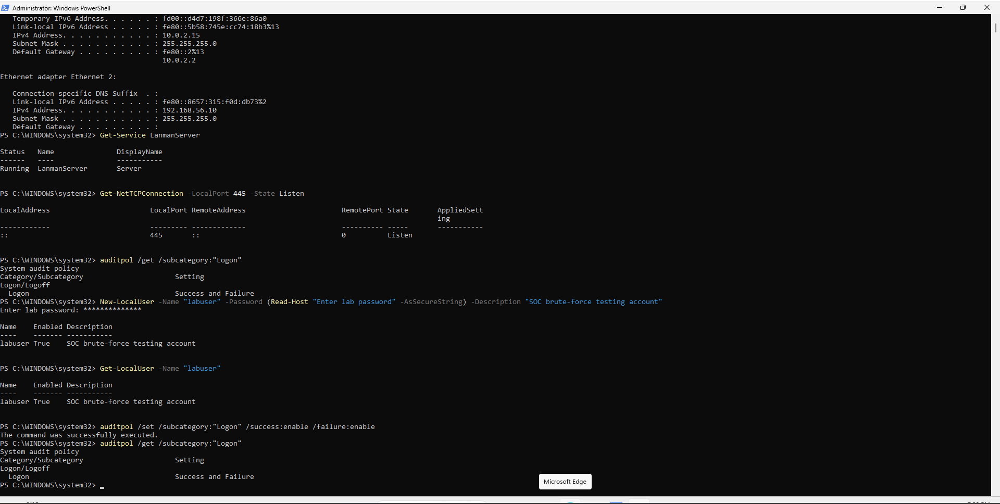
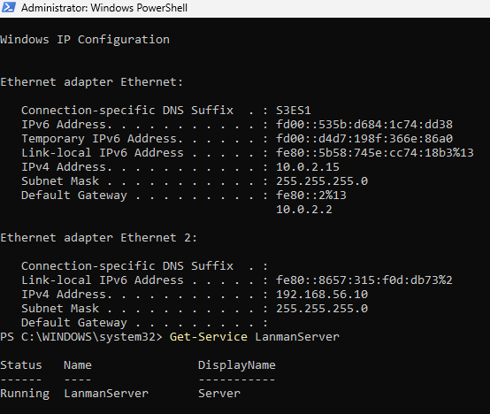
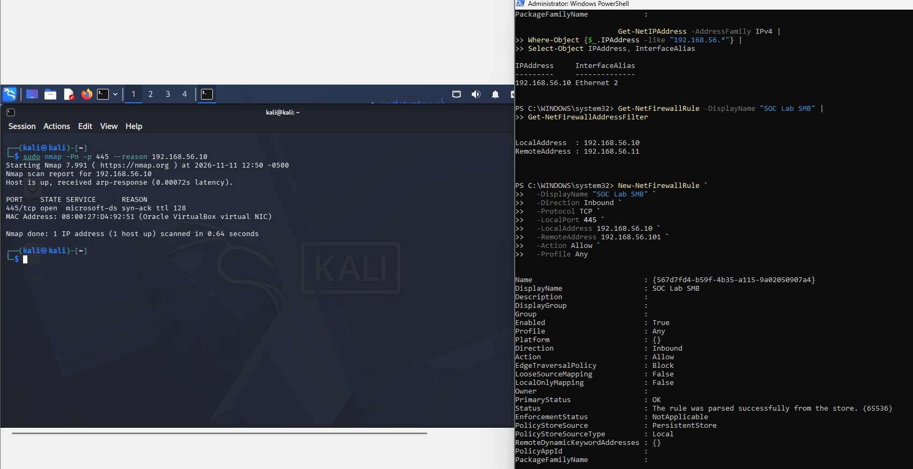
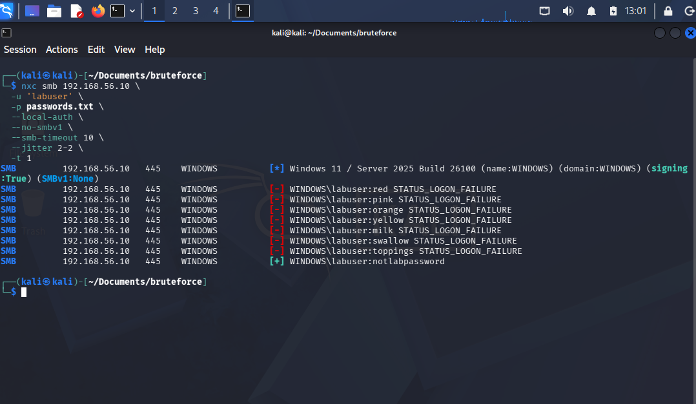
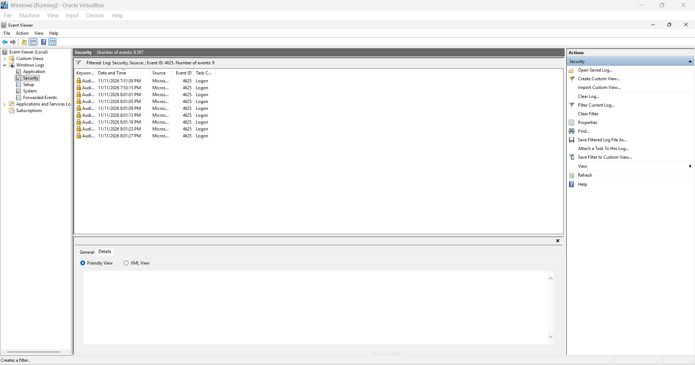
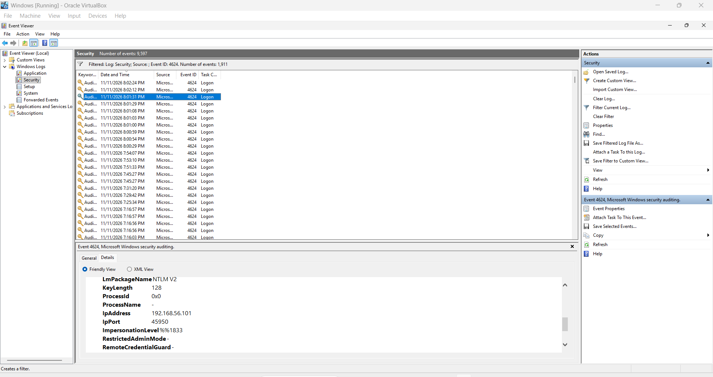
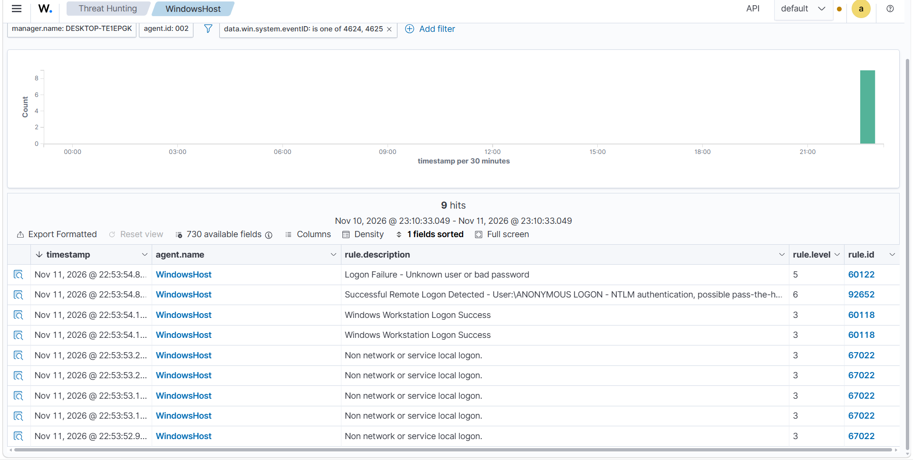
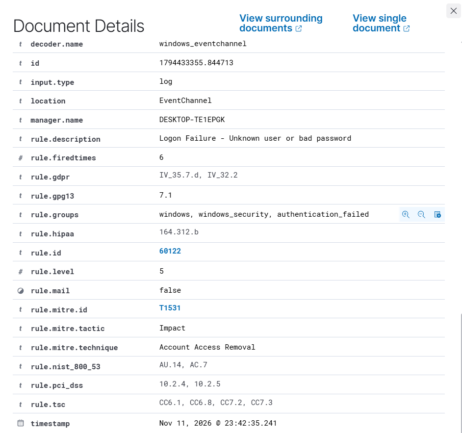
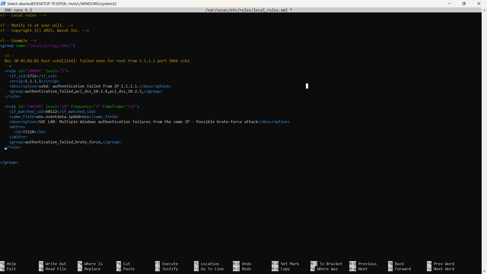
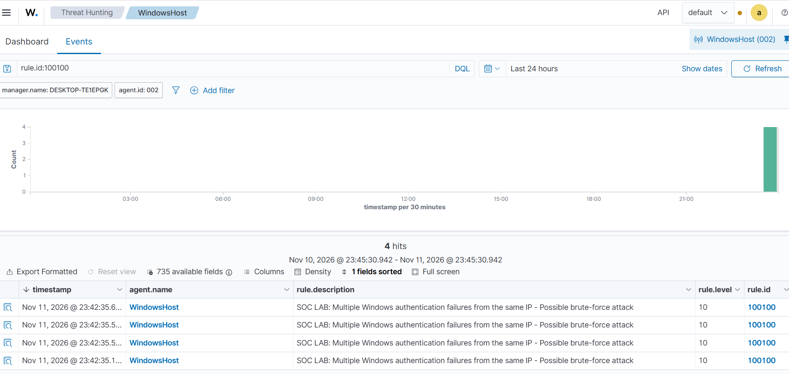

# Title

**Environtment:**
**Test date:**
**MITRE ATT&CK:**

## 1. Executive Summary

## 2. Objective and Scope

## 3. Test Environment

## 4. Methodology and Evidence

### 4.1 Preparation
A test account was created to safely conduct this brute-force attack, with the username `labuser`. The IP address of the victim was also obtained.



I created a firewall rule on the victim machine. The rule allows for the kali to communicate over the smb port 445.
`New-NetFirewallRule -DisplayName "SOC Lab SMB" -Direction Inbound -Protocol TCP -LocalPort 445 -LocalAddress 192.168.56.10 -RemoteAddress 192.168.56.101 -Action Allow -Profile Any`


To verify the issue was fixed, I ran nmap on the kali and the port was shown open.

### 4.2 Brute Force SMB

I created a small password list used to brute force the smb. I began to brute force the victim's SMB port using
`nxc smb 192.168.56.10 -u 'labuser' -p password.txt --local-auth --no-smbv1 --smb-timeout 10 --jitter 2-2 -t 1`.


### 4.3 Event Viewer Logs

The events were logged on the victim's event viewer, Found in the Security Log. Using a event filter to find the Failed logged attempts with eventid:4625.
.
Using the event filter to find the Successful logged attempts with eventid:4624.
.

### 4.4 Wazuh Alerts

On the Wazuh dashboard's Threat Hunting page, the events were logged. The failed logon attempts and successful logon were recorded.
.
Taking a look into the failed attempts log details, we take note of the RuleID:60122, Logon Failure - Uknown users or bad password with `timestamp: 11 Nov 23:42:35.241` and level severity 5. The Mitre Att&ck information is also captured with MitreID: T1531, Tactic: Impact, Technique: Account Access Removal
.

### 4.5 Create New Wazuh Rule

To create a new rule, must be accessed at `sudo nano /var/ossec/etc/rules/local-rules.xml`

The following rule has ID 100100. if the same Source IP Address attempts the same failed logon attempts at least 4 times, the rule is triggered with severity 10 and maps to brute-force Mitre At&ck T1110.
```xml
<rule id="100100" level="10" frequency="4" timeframe="120">
  <if_matched_sid>60122</if_matched_sid>
  <same_field>win.eventdata.ipAddress</same_field>
  <description>SOC LAB: Multiple Windows authentication failures from the same IP - Possible brute-force attack</description>
  <mitre><id>T1110</id></mitre>
  <group>authentication_failed,brute_force,</group>
</rule>
```
.

### 4.6 Test New Rule

The same attack command was executed using the small password to brute force the victim's SMB port. The alerts were captured on Wazuh Dashboard, triggering the new rule on the 4th attempt, with severity level 10.
.

## 5. Findings and Interpretation

## 6. Incident timeline

## 7. Responses and Remediation

## 8. Lessons learned and Limitations

## 9. Evidence index

| Figure | Filename | Purpose |
| --- | --- | --- |
| 1 | `screenshots/01-lab-account.png` | Test account |
| 2 | `screenshots/02-target-ip-smb.png` | Target IP and SMB |
| 3 | `screenshots/03-smb-troubleshooting.png` | Connection issue |
| 4 | `screenshots/04-firewall-fix.png` | Scoped firewall troubleshooting |
| 5 | `screenshots/05-netexec-password-spray.png` | Initial test results |
| 6 | `screenshots/06-windows-failed-logins.png` | Windows failure records |
| 7 | `screenshots/07-windows-success-event.png` | Windows success records — verify attribution |
| 8 | `screenshots/08-event-viewer-evidence.png` | Endpoint record detail |
| 9 | `screenshots/09-wazuh-failure-alerts.png` | Wazuh baseline alerts |
| 10 | `screenshots/10-wazuh-success-details-unverified.png` | ANONYMOUS LOGON; not evidence of labuser success |
| 11 | `screenshots/11-custom-rule-xml.png` | Detection rule implementation |
| 12 | `screenshots/12-custom-rule-alert.png` | Correlation trigger |
| 13 | `screenshots/13-wazuh-timeline.png` | Event timeline view |

## 10. References

- [MITRE ATT&CK T1110 — Brute Force](https://attack.mitre.org/techniques/T1110/)
- [Wazuh rules syntax documentation](https://documentation.wazuh.com/current/user-manual/ruleset/ruleset-xml-syntax/rules.html)
- [Microsoft Event 4625 documentation](https://learn.microsoft.com/en-us/windows/security/threat-protection/auditing/event-4625)
- [Microsoft Event 4624 documentation](https://learn.microsoft.com/en-us/windows/security/threat-protection/auditing/event-4624)
