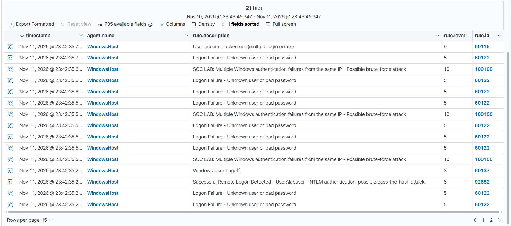

# Title

**Environtment:**
**Test date:**
**MITRE ATT&CK:**

## 1. Executive Summary

An SMB password-guessing simulation was carried out from Kali Linux against the local `labuser` account on an isolated Windows 11 VM (`192.168.56.10`, TCP port `445`). NetExec displayed several rejected passwords followed by an accepted credential. Windows security logging and Wazuh supplied authentication evidence. Wazuh's existing rule **60122** flagged individual logon failures at level **5**. A custom Wazuh correlation rule, **100100**, was then configured to flag repeated failures from the same source IP within a 120-second window at level **10**. The dashboard screenshot shows **four alerts** for rule 100100, demonstrating that the custom detection triggered during the later test. No real-world compromise is claimed.

## 2. Objective and Scope

- Validate Windows SMB authentication telemetry and Wazuh ingestion.
- Reproduce repeated incorrect password attempts against a **lab-only** account.
- Distinguish single-event detection from higher-severity correlation.
- Document analyst findings and identify improvements.

**Scope:** Kali attacker VM and Windows victim VM connected via an isolated VirtualBox host-only network; Wazuh Manager and Dashboard hosted under Ubuntu/WSL2. No production systems or external targets were tested.

## 3. Test Environment

| Component | Role | Evidence |
| --- | --- | --- |
| Kali Linux | Controlled test source running NetExec | Fig. 5 |
| Windows 11 (`192.168.56.10`) | Victim endpoint, local account `labuser`, SMB on TCP/445 | Figs. 1–2 |
| Windows Event Viewer | Endpoint authentication evidence (Security log) | Figs. 6–8 |
| Wazuh (`WindowsHost`, agent `002`) | SIEM ingestion, alerting and correlation | Figs. 9–13 |

**Attacker/source IP:** [Insert verified Kali IP from the matching Windows/Wazuh event]. Do not assume the example IP used during firewall troubleshooting was the actual event source.

## 4. Methodology and Evidence

### 4.1 Preparation

A dedicated test account named `labuser` was created on the Windows 11 virtual machine to safely conduct the brute-force simulation. The victim machine's IP address was also identified to establish the target for the attack.


During the initial connectivity testing, Kali was unable to establish an SMB connection with the victim machine. To resolve this, a Windows Firewall rule was created to allow inbound SMB traffic on TCP port 445 from Kali's IP address.

The following PowerShell command was executed on the Windows VM:

```powershell
New-NetFirewallRule -DisplayName "SOC Lab SMB" -Direction Inbound -Protocol TCP -LocalPort 445 -LocalAddress 192.168.56.10 -RemoteAddress 192.168.56.101 -Action Allow -Profile Any
```


To verify that the connectivity issue had been resolved, an Nmap scan was performed from Kali. The results confirmed that TCP port 445 was open and accessible, allowing the SMB authentication tests to proceed.

### 4.2 SMB Brute-Force Simulation

A small password list was created containing several possible passwords, including the correct password for the `labuser` account. The objective was to simulate an attacker attempting multiple passwords against a single account until valid credentials were identified.

NetExec was used to perform the password-guessing attack against the victim's SMB service using the following command:

```bash
nxc smb 192.168.56.10 -u 'labuser' -p password.txt --local-auth --no-smbv1 --smb-timeout 10 --jitter 2-2 -t 1
```

The command targeted the local `labuser` account, tested passwords from the specified file, disabled SMBv1 negotiation, and introduced a delay between authentication attempts.

The simulation generated multiple failed authentication attempts before successfully identifying the correct password.


### 4.3 Windows Event Viewer Investigation

Following the attack, Windows Event Viewer was examined to determine whether the authentication attempts had been recorded.

The relevant events were located under **Event Viewer → Windows Logs → Security**.

A filter was applied for **Event ID 4625**, which represents a failed logon attempt. The resulting events provided evidence of unsuccessful authentication attempts against the victim machine.


A second filter was applied for **Event ID 4624**, which represents a successful logon. The corresponding events were examined to investigate successful authentication activity recorded during the testing period.


These Windows Security events provided the initial evidence required to investigate the authentication activity and correlate it with the alerts generated by Wazuh.

### 4.4 Wazuh Alert Investigation

The authentication events were successfully collected and displayed in the **Threat Hunting** section of the Wazuh dashboard. Both failed and successful logon events were visible, confirming that Windows authentication activity was being forwarded to the SIEM.


Further investigation of a failed authentication alert revealed the following information:

- **Rule ID:** 60122
- **Description:** Logon Failure - Unknown user or bad password
- **Severity Level:** 5
- **Timestamp:** 11 November, 23:42:35.241
- **MITRE ATT&CK ID:** T1531
- **MITRE Tactic:** Impact
- **MITRE Technique:** Account Access Removal


Rule `60122` identified individual failed authentication attempts. However, a single failed login does not necessarily indicate a brute-force attack, as legitimate users may occasionally enter incorrect credentials.

The MITRE mapping displayed in this existing alert was T1531 (Account Access Removal). This differs from the password-guessing activity observed in the simulation, which is more accurately classified under **T1110.001 — Password Guessing**.

To improve detection of repeated authentication failures, a custom Wazuh correlation rule was developed.

### 4.5 Custom Wazuh Detection Rule

A custom detection rule was created to identify potential brute-force activity by correlating multiple failed authentication attempts originating from the same source IP address.

The Wazuh local rules configuration file was accessed using:

```bash
sudo nano /var/ossec/etc/rules/local_rules.xml
```

The following rule was added:

```xml
<rule id="100100" level="10" frequency="4" timeframe="120">
  <if_matched_sid>60122</if_matched_sid>
  <same_field>win.eventdata.ipAddress</same_field>
  <description>SOC LAB: Multiple Windows authentication failures from the same IP - Possible brute-force attack</description>
  <mitre>
    <id>T1110</id>
  </mitre>
  <group>authentication_failed,brute_force,</group>
</rule>
```


The custom rule, identified as **100100**, correlates failed authentication events previously detected by rule `60122`.

It is configured to generate a severity-level-10 alert when four matching authentication failures originate from the same source IP address within a 120-second period.

The `<same_field>` condition ensures that the correlated authentication failures originate from the same IP address, while the MITRE ATT&CK mapping associates the detection with **T1110 — Brute Force**.

Unlike rule `60122`, which identifies individual authentication failures, the custom rule focuses on repeated failures that may indicate an attempted brute-force attack.

The rule provides an additional detection capability without automatically blocking the source IP address or locking the targeted account.

### 4.6 Custom Rule Validation

To verify that the custom detection rule functioned as intended, another controlled SMB password-guessing test was performed against the Windows VM.

The test generated repeated failed authentication attempts using NetExec. The resulting events were collected by Wazuh and evaluated against the newly configured correlation rule.

On the fourth failed authentication attempt, **rule 100100 was triggered**, generating a severity-level-10 alert in the Wazuh dashboard.


The successful detection confirmed that Wazuh could correlate repeated authentication failures from the same source IP address and generate a higher-severity alert for potential brute-force activity.

This demonstrated the effectiveness of the custom detection rule under the tested conditions and its ability to supplement Wazuh's existing authentication monitoring.

The activity was mapped to **MITRE ATT&CK T1110 — Brute Force**, specifically **T1110.001 — Password Guessing**, as the simulation involved testing multiple passwords against a single account.

The successful validation also demonstrated the distinction between detecting individual security events and correlating multiple events to identify a potentially malicious pattern.

## 5. Incident timeline

| Local time + timezone | Source | Observed event | Correlation details |
| --- | --- | --- | --- |
| [Date/time] | Kali NetExec | First failed password candidate | `labuser`, target 192.168.56.10 |
| [Date/time] | Windows Security | Event 4625 | Source IP, logon type, account name |
| [Date/time] | Kali NetExec | Credential accepted | Screenshot 5 |
| [Date/time] | Windows Security | Matching Event 4624, **if verified** | Do not substitute ANONYMOUS LOGON |
| [Date/time — later test] | Wazuh | Rule 100100, level 10 | Repeated failed logons from one source |



**Time handling:** Kali, Windows and Wazuh may display different timezones; convert them to one stated timezone before finalising the incident chronology.

## 6. Responses and Remediation

## 7. Lessons learned and Limitations

## 8. Evidence index

| Figure | Filename | Purpose |
| --- | --- | --- |
| 1 | `screenshots/01-lab-account.png` | Test account |
| 2 | `screenshots/02-target-ip-smb.png` | Target IP and SMB |
| 3 | `screenshots/03-smb-troubleshooting.png` | Connection issue |
| 4 | `screenshots/04-firewall-fix.png` | Scoped firewall troubleshooting |
| 5 | `screenshots/05-netexec-password-spray.png` | Initial test results |
| 6 | `screenshots/06-windows-failed-logins.png` | Windows failure records |
| 7 | `screenshots/07-windows-success-event.png` | Windows success records — verify attribution |
| 8 | `screenshots/08-event-viewer-evidence.png` | Endpoint record detail |
| 9 | `screenshots/09-wazuh-failure-alerts.png` | Wazuh baseline alerts |
| 10 | `screenshots/10-wazuh-success-details-unverified.png` | ANONYMOUS LOGON; not evidence of labuser success |
| 11 | `screenshots/11-custom-rule-xml.png` | Detection rule implementation |
| 12 | `screenshots/12-custom-rule-alert.png` | Correlation trigger |
| 13 | `screenshots/13-wazuh-timeline.png` | Event timeline view |

## 10. References

- [MITRE ATT&CK T1110 — Brute Force](https://attack.mitre.org/techniques/T1110/)
- [Wazuh rules syntax documentation](https://documentation.wazuh.com/current/user-manual/ruleset/ruleset-xml-syntax/rules.html)
- [Microsoft Event 4625 documentation](https://learn.microsoft.com/en-us/windows/security/threat-protection/auditing/event-4625)
- [Microsoft Event 4624 documentation](https://learn.microsoft.com/en-us/windows/security/threat-protection/auditing/event-4624)
