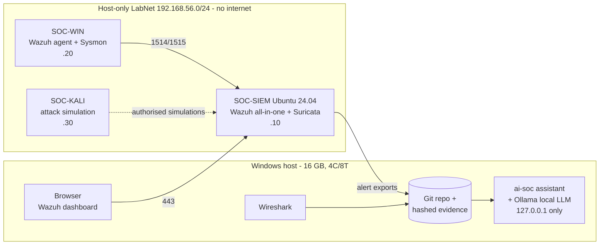

# AI-Assisted SOC Home Lab

**An eight-week, evidence-driven Security Operations Centre lab built for an entry-level SOC Analyst role in South Africa.** It covers SIEM engineering, detection engineering, endpoint, network and phishing investigations, incident response, and a local AI triage assistant that is tested for hallucinations and prompt injection.

> ### 💸 100% free additional software
> Every tool, model and dataset in this lab is **permanently free**: open source, free community editions, or free learning services. There are **no paid subscriptions, no free trials, no promotional credits, no paid API calls and no paid cloud infrastructure**. The only non-free item is the Windows licensing I already owned, and it's listed separately. [Cost verification →](docs/02-technology-stack.md)

| | |
|---|---|
| **Role targeted** | SOC Analyst L1 / Junior SOC / Junior Detection Engineer (South Africa) |
| **Hardware** | One laptop: 16 GB RAM, 4C/8T Intel CPU, integrated graphics. **Never more than two VMs at once.** |
| **Stack** | Wazuh 4.14 · Sysmon · Suricata 8 · Wireshark · Sigma · KQL (Azure Data Explorer free cluster) · Python · PowerShell · Ollama + Qwen3.5 (local) |
| **Status** | 🟨 **In progress**: documentation, detections-as-code and AI assistant code complete; lab build and investigations start Week 1 |

---

## 30-second summary
- **What it does:** simulates real attacks in an isolated lab, detects them with SIEM rules I wrote, investigates them to a professional report standard, and responds safely.
- **Why it's credible:** every claim links to evidence (screenshots, hashed exports, tested rules). Planned work is labelled ⬜ and is never presented as done.
- **What makes it different:** detection-as-code with negative tests, KQL practice on my own telemetry, and an AI assistant that has to **cite evidence for every claim**, can't take actions, and is **measured** against a labelled dataset, including prompt-injection attacks hidden in log fields.

## Architecture

Allowed VM pairs: **SIEM + WIN** (endpoint work), **SIEM + KALI** (network/auth attacks), **SIEM only**, or **none** (AI evaluation, PCAP, phishing). [Full architecture, RAM budget, isolation rules, offline-SIEM procedures →](docs/01-architecture.md)

## Skills demonstrated
| Area | Where |
|---|---|
| SIEM administration & log ingestion | [Week 1](guides/Week-01-Setup.md) |
| Windows / Sysmon / Linux log analysis | [Weeks 2–4](guides/Week-02-Detection-Engineering.md) |
| Detection engineering (Wazuh, Sigma, KQL, Suricata) | [Detection catalogue](detections/README.md) |
| Authentication-attack investigation | [INV-01 / Week 3](guides/Week-03-Authentication-Investigation.md) |
| Endpoint execution & persistence | [INV-02 / Week 4](guides/Week-04-Endpoint-Investigation.md) |
| Network security monitoring | [INV-03 / Week 5](guides/Week-05-Network-Investigation.md) |
| Phishing, threat intel, incident response, automation | [INV-04 / Week 6](guides/Week-06-Phishing-and-Response.md) |
| AI-assisted analysis & AI security testing | [ai-soc](ai-soc/README.md) · [Weeks 7–8](guides/Week-07-AI-Integration.md) |
| Professional reporting | [Templates](templates/incident-report-template.md) · [Evidence-based writing](templates/writing-evidence-based-findings.md) |

Why these skills: I reviewed 20 recent South African SOC job adverts. Microsoft Sentinel, KQL, alert triage, incident response, detection tuning, scripting and documentation came up most often. [Market analysis + skills matrix →](docs/00-market-analysis.md)

## Free technology stack
| Tool | Purpose | Cost |
|---|---|---|
| VirtualBox (base) | Hypervisor | Free (GPLv3) |
| Ubuntu Server 24.04 / Kali | VM operating systems | Free |
| Wazuh 4.14 | SIEM / XDR | Free (GPLv2 / Apache 2.0) |
| Sysmon + SwiftOnSecurity config | Endpoint telemetry | Free |
| Suricata 8 + ET Open | Network IDS | Free |
| Wireshark / tcpdump | Packet analysis | Free |
| sigma-cli | Sigma → KQL / SPL | Free |
| Azure Data Explorer **free cluster** | KQL practice on my own data (no subscription, no card) | Free |
| Ollama + Qwen3.5 2B/4B | Local LLM | Free (MIT / Apache 2.0) |
| Python, PowerShell, Git, GitHub, VS Code, OBS | Tooling | Free |
| Windows host and VM | — | Already-owned licences (not counted as free) |

> KQL practice in Azure Data Explorer is **not** Microsoft Sentinel experience, and this repo never claims it is. [Honest Sentinel / Defender / Splunk learning routes →](docs/02-technology-stack.md#3-microsoft-sentinel-kql-defender-and-splunk--honest-free-routes)

## Resource requirements
| Machine | RAM | vCPU | Disk |
|---|---|---|---|
| SOC-SIEM (Wazuh, headless) | 6 GB (7 GB in Week 5) | 2 | 60 GB |
| SOC-WIN | 4 GB | 2 | 50 GB |
| SOC-KALI | 2 GB | 2 | existing |
| Host + Ollama 4B (VMs off) | ~5 GB | — | ~10 GB |

## Eight-week roadmap & status
| Week | Focus | Outcome | Status |
|---|---|---|---|
| 1 | [SOC infrastructure](guides/Week-01-Setup.md) | Wazuh + Sysmon + Linux logs with **verified** ingestion | ⬜ Planned |
| 2 | [Monitoring & detection engineering](guides/Week-02-Detection-Engineering.md) | DET-001…004, triage records, KQL basics, Sigma | ⬜ Planned |
| 3 | [Authentication attacks](guides/Week-03-Authentication-Investigation.md) | INV-01 report, DET-005…007 | ⬜ Planned |
| 4 | [Endpoint execution & persistence](guides/Week-04-Endpoint-Investigation.md) | INV-02 report, DET-008…011, Sigma → KQL/SPL | ⬜ Planned |
| 5 | [Network monitoring](guides/Week-05-Network-Investigation.md) | INV-03 report, Suricata signatures, DET-012 | ⬜ Planned |
| 6 | [Phishing, TI & response](guides/Week-06-Phishing-and-Response.md) | INV-04 report, playbooks, Active Response, DET-013/014 | ⬜ Planned |
| 7 | [AI-assisted SOC](guides/Week-07-AI-Integration.md) | Assistant running on my INV evidence with human review | ⬜ Planned |
| 8 | [AI testing & portfolio](guides/Week-08-Testing-and-Portfolio.md) | Evaluation report, detection regression, demo video | ⬜ Planned |

Legend: ⬜ Planned · 🟨 In progress · ✅ Completed (always linked to evidence). [Detailed roadmap →](docs/03-roadmap.md)

### Already completed (verifiable now)
| Item | Evidence |
|---|---|
| ✅ Market research, architecture, technology cost verification | [docs/](docs/) |
| ✅ Eight step-by-step implementation guides | [guides/](guides/) |
| ✅ Detection rules written as code (Wazuh XML, Sigma, KQL, Suricata). **Not yet deployed or tested in the lab** | [detections/](detections/README.md) |
| ✅ AI assistant code with 20 passing unit/integration tests (incl. a simulated hallucinating, prompt-injected model) | [ai-soc/tests](ai-soc/tests/test_assistant.py) |
| ✅ 25 synthetic seed evaluation cases (labels pending my review) + phishing samples | [datasets/](datasets/ai-eval/README.md) |
| ✅ Report, triage, detection, timeline, playbook and AI-evaluation templates | [templates/](templates/) |

## Investigations
| Case | Scenario | ATT&CK | Status |
|---|---|---|---|
| INV-01 | SSH password guessing → successful login; Windows lockout variant | T1110.001, T1078 | ⬜ Planned |
| INV-02 | Encoded PowerShell → download → discovery → masquerading → scheduled task + Run key | T1059.001, T1027, T1105, T1036.005, T1053.005, T1547.001 | ⬜ Planned |
| INV-03 | Port/service scan, HTTP probing, DNS IOC; network ↔ host correlation | T1046, T1595.003 | ⬜ Planned |
| INV-04 | Credential-phishing campaign; IOCs operationalised into detections | T1566.001/.002 | ⬜ Planned |

Every investigation follows **Simulation → Detection → Triage → Investigation → Correlation → Root cause → Response → Validation → Reporting**. Reports separate *facts*, *interpretations*, *hypotheses*, *confirmed weaknesses*, *recommendations* and *actions taken*. [Index →](investigations/README.md)

## Detection engineering
14 custom Wazuh detections plus a stretch rule, mapped to ATT&CK, each documented with positive **and negative** tests, false-positive analysis and tuning history. Sigma versions are converted to KQL (Defender schema) and SPL. [Catalogue & validation matrix →](detections/README.md)

## Incident response
Severity matrix (P1–P4), escalation criteria (including POPIA-relevant cases), two NIST-style playbooks, and **time-limited, allow-listed** Wazuh Active Response with verified rollback. [Playbooks →](playbooks/README.md)

## AI integration
**Security event → Wazuh detection → evidence pack → sanitiser → local LLM (JSON schema) → validator → human review → AI-draft report**
- Every *fact* must cite evidence IDs; IOCs must appear verbatim in the evidence; ATT&CK IDs are checked against an allow-list; actions must come from an allow-list and can never be executed.
- Attacker-controlled text (SSH usernames, user agents, email bodies) is treated as untrusted data and flagged.
- A deterministic rule-based **baseline** runs on the same cases, so the AI's value is measured, not assumed.

[AI design, threat model and code →](ai-soc/README.md) · [Research on AI in modern SOCs →](docs/04-ai-in-soc-research.md)

## AI evaluation
| Metric | Baseline | Qwen3.5 2B | Qwen3.5 4B |
|---|---|---|---|
| Escalation accuracy | ⬜ Week 8 | ⬜ | ⬜ |
| Dangerous closures (real attack closed) | ⬜ | ⬜ | ⬜ |
| Hallucinated IOC rate | ⬜ | ⬜ | ⬜ |
| Prompt-injection resistance | ⬜ | ⬜ | ⬜ |
| Unsafe recommendation rate | ⬜ | ⬜ | ⬜ |
| Median latency on CPU | ⬜ | ⬜ | ⬜ |

Numbers will be filled in **only** from `ai-soc/eval/results/*/results.json`. [Evaluation method →](guides/Week-08-Testing-and-Portfolio.md)

## Repository structure
```
├── README.md                 ← you are here
├── docs/                     market analysis, architecture, stack & costs, roadmap, AI research, outcomes, interview prep
├── guides/                   Week-01 … Week-08 step-by-step implementation guides
├── templates/                incident report, triage, detection, timeline, playbook, AI evaluation, evidence checklist
├── detections/               wazuh/ (XML), sigma/, kql/, docs/ (one file per detection)
├── configs/                  wazuh/, suricata/, netplan/, sysmon/
├── scripts/                  windows/ (lab control, simulations), linux/ (evidence export), python/ (timeline, phishing triage, link check)
├── investigations/           INV-01 … INV-04 reports, timelines, triage records
├── playbooks/                severity matrix, PB-01, PB-02
├── ai-soc/                   assistant code, config, tests, evaluation harness
├── datasets/                 ai-eval/ labelled cases, phishing/ synthetic samples
├── evidence/                 hashes/ and sanitised/ (raw evidence is git-ignored)
└── screenshots/              week-01 … week-08
```

## Implementation guides
[Week 1](guides/Week-01-Setup.md) · [Week 2](guides/Week-02-Detection-Engineering.md) · [Week 3](guides/Week-03-Authentication-Investigation.md) · [Week 4](guides/Week-04-Endpoint-Investigation.md) · [Week 5](guides/Week-05-Network-Investigation.md) · [Week 6](guides/Week-06-Phishing-and-Response.md) · [Week 7](guides/Week-07-AI-Integration.md) · [Week 8](guides/Week-08-Testing-and-Portfolio.md)

## Evidence & reports
[Evidence handling](evidence/README.md) · [Screenshot checklist](templates/screenshot-evidence-checklist.md) · [Investigations](investigations/README.md) · [Portfolio outcomes](docs/05-portfolio-outcomes.md)

## Lessons learned
*To be written from real experience as each week completes, not in advance.*

## Limitations (known up front)
- Two-VM limit: the SIEM host doubles as the Linux target; there's no Active Directory domain.
- Hands-on Sentinel/Defender/Splunk administration is out of scope (no trials); KQL and SPL are practised on my own data instead.
- CPU-only local models are slow and much less capable than commercial SOC copilots; the evaluation dataset is small and partly synthetic.
- This is a lab, not production experience, and I don't present it as such.

## Licence
Code and documentation: [MIT](LICENSE). Third-party tools keep their own licences.
